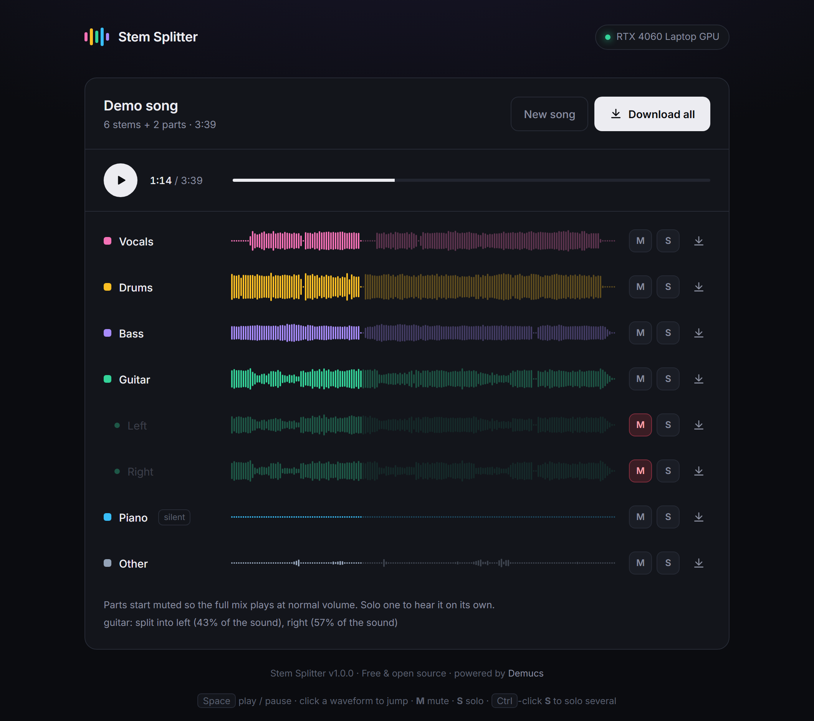
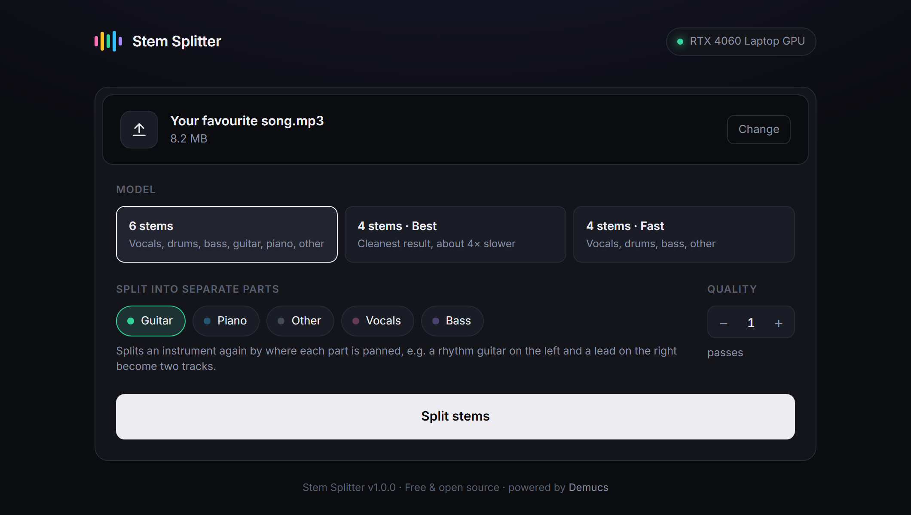

# Stem Splitter

**Split any song into vocals, drums, bass, guitar, piano and more. Free, private, and on your own PC.**

[**⬇ Download for Windows**](../../releases/latest) · [How to use](#how-to-use-it) · [FAQ](#faq)

## What it does

Drop in a song and Stem Splitter uses AI to pull it apart into separate tracks ("stems"):
**vocals, drums, bass, guitar, piano** and **everything else**. Use them to make karaoke or
backing tracks, learn a part by ear, remix, sample, or practice along with the band minus your
instrument.

- 🎸 **Splits two guitars apart.** It doesn't stop at one "guitar" stem. When a song has, say,
  a rhythm guitar on the left and a lead on the right, it separates them into their own tracks.
- 🎧 **Listen before you download.** Every stem plays in sync, like a mini mixer, with
  **mute** and **solo** on each track, so you can check the result first.
- 🔒 **Private.** Everything runs on your computer. Your music is never uploaded anywhere.
- 💸 **Free.** No account, no limits, no watermark, no subscription.
- ⚡ **Fast on NVIDIA graphics cards:** about 20–40 seconds per song. It also works without
  one, just slower (a few minutes per song).
- 🎵 **Takes almost any file:** mp3, wav, flac, m4a, ogg, and even video files.

## Download and install

> **Windows 10 or 11** · about 6 GB of free disk space · internet for the first start only

1. Download **`StemSplitter-vX.Y.Z.zip`** from the [**latest release**](../../releases/latest).
2. **Unzip it** anywhere, for example to your Desktop (right-click → *Extract All*).
3. Double-click **`Stem Splitter.bat`**.

That's it. You don't need to install Python or anything else. The first start sets everything up
by itself (about 3 GB with an NVIDIA graphics card, about 1 GB without) and takes a few minutes.
After that, the app opens in your browser within seconds and works offline.

> **Seeing "Windows protected your PC"?** Windows shows this for free apps that aren't
> commercially signed. Click **More info → Run anyway**.

## How to use it

1. **Drop a song** onto the page, or click to pick a file.
2. **Pick a model:**

   | Model | You get | Best for |
   |---|---|---|
   | **6 stems** (default) | vocals, drums, bass, guitar, piano, other | most songs |
   | **4 stems · Best** | vocals, drums, bass, other | the cleanest vocals and drums (about 4× slower) |
   | **4 stems · Fast** | vocals, drums, bass, other | quick results |

3. **Split into separate parts** (optional): tick an instrument, and its stem is split again into
   the individual parts based on where each one sits in the stereo mix (left, center or right).
   Guitar is ticked by default.
4. Click **Split stems** and wait for the progress bar.
5. **Check the result:** press <kbd>Space</kbd> to play and click any waveform to jump.
   **M** mutes a track, **S** solos it (<kbd>Ctrl</kbd>-click **S** to solo several).
6. **Download** the stems you want one by one with the ⬇ icon, or all at once with
   **Download all**. Files are 24-bit WAV.

## FAQ

**Does it work on Mac or Linux?**
Not yet. It's Windows-only for now.

**Do I need a graphics card?**
No. With an NVIDIA card it's fast. Without one it runs on your processor and takes a few
minutes per song. AMD and Intel graphics cards also use the processor.

**Why didn't my two guitars get separated?**
Parts are told apart by where they sit in the stereo mix. If both guitars are panned to the
same place (for example both in the middle), they can't be split this way, and the app says so.

**Where's the violin / synth / saxophone stem?**
The AI models know vocals, drums, bass, guitar and piano. Everything else ends up in "other".

**How do I uninstall it?**
Delete the app folder and the folder `%USERPROFILE%\.stemsplitter`, which holds the downloaded
Python, PyTorch and AI models.

**Something went wrong.**
Close the black window and double-click `Stem Splitter.bat` again. If setup failed halfway
(for example because the internet dropped), it retries automatically. Still stuck?
[Open an issue](../../issues) and paste the text from the black window.

## How it works

1. **AI separation:** [Demucs](https://github.com/facebookresearch/demucs) (Meta AI's
   Hybrid Transformer models) splits the mix into instrument stems.
2. **Part splitting:** a stem is split again by stereo position. The app finds the pan positions
   where most of the sound sits and unmixes every frequency between them. For two parts recorded
   separately and panned hard left and right (very common for rock guitars), it detects that the
   two channels are unrelated and separates them exactly. The parts always add back up to the
   original stem.

<b>For developers</b>

| File | What it is |
|---|---|
| `engine.py` | The separation pipeline. Also works from the command line: `python engine.py song.mp3 --split guitar` |
| `app.py` | A local FastAPI server that runs splits and serves the page |
| `static/index.html` | The whole interface: layout, mixer, waveforms (no build step) |
| `setup.bat` | A self-contained installer. Uses [uv](https://github.com/astral-sh/uv) to fetch Python 3.12, then PyTorch (CUDA 12.8 build with an NVIDIA card, CPU build otherwise) and `requirements.txt` into `%USERPROFILE%\.stemsplitter` |
| `config.json` | The version, plus optional donation and project links shown in the app |
| `make_release.ps1` | Builds the release zip into `dist\` |

## Credits and license

Separation models by [Demucs](https://github.com/facebookresearch/demucs) (Meta AI, MIT license).
Stem Splitter is MIT licensed; see [`LICENSE`](LICENSE). Made by **eatbae**.
